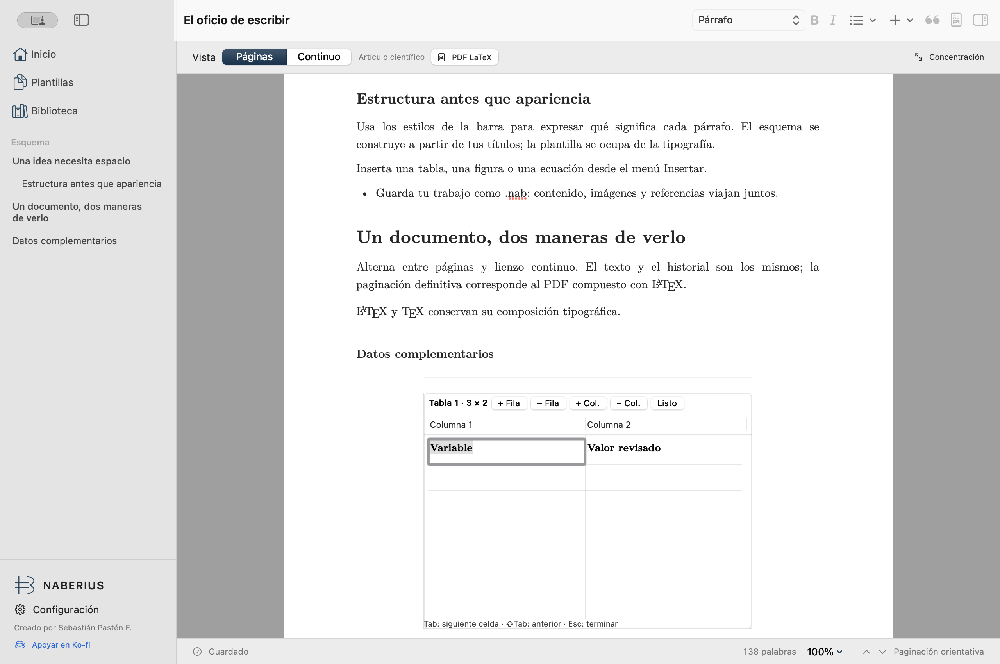

<p align="center">
  
</p>
<h1 align="center">NABERIUS</h1>
<p align="center">Escritura visual. Composición precisa.</p>
<p align="center">
  
  
  
  <a href="LICENSE"></a>
</p>
<p align="center"><a href="#comenzar">Comenzar</a> · <a href="#capacidades">Capacidades</a> · <a href="#validación">Validación</a> · <a href="CONTRIBUTING.md">Contribuir</a> · <a href="https://ko-fi.com/C0C51WQ1T0">Apoyar en Ko-fi</a></p>

Editor académico nativo para macOS, de la familia METATRON, RAZIEL y PAIMON. Escribe con estilos y objetos semánticos; Tectonic compone el PDF final mediante LaTeX. Texto, imágenes, plantilla y referencias viajan juntos en un archivo `.nab`.

**Creado por Sebastián Pastén F.** · **Versión 0.3.0**



Captura de la app instalada. El documento usa Latin Modern y el PDF final se compone con Tectonic. [Página de PDF real](docs/typesetting/article-page-1.png) · [Tipografía y composición](docs/TYPESETTING.md).

<details>
<summary>Apariencia oscura e importación bibliográfica</summary>


</details>

## Comenzar

Descarga la app desde [Releases](https://github.com/AD0441/NABERIUS/releases) o compílala desde el código. Requiere macOS 14 o posterior; la versión se verifica en Apple M1 con 8 GB. El ZIP tiene firma ad hoc y no está notarizado. Tectonic se instala por separado; puedes escribir y exportar el proyecto LaTeX sin tenerlo disponible.

Con Xcode y Swift 6.2 o posterior:

```sh
git clone https://github.com/AD0441/NABERIUS.git
cd NABERIUS
./script/build_and_run.sh
```

El script crea y verifica el bundle, produce `dist/Naberius.zip` e instala `~/Applications/Naberius.app`. La copia instalada evita que la sincronización del Escritorio añada metadatos que invaliden la firma. `--build-only` solo genera el ZIP; `NABERIUS_APP_DIR` permite elegir el destino de instalación. Otras opciones: `--verify`, `--demo`, `--debug`, `--logs`.

1. Crea un documento en blanco o selecciona una plantilla.
2. Aplica estilos: título, apartados, párrafo, cita extensa o listas. El esquema sigue los títulos.
3. Inserta tablas, figuras, ecuaciones, notas, índice y referencias cruzadas desde **Insertar**.
4. En una tabla, haz doble clic para editar dentro del documento. **Tab / ⇧Tab** cambian de celda, **Intro** avanza de fila y **Esc** termina. Tab en la última celda añade una fila hasta el límite de 200.
5. En **Biblioteca → Importar**, revisa registros, campos y advertencias antes de añadir las fuentes seleccionadas.
6. Guarda con **⌘S**. Abre **PDF LaTeX** y pulsa **Actualizar PDF** para ver la composición final. Si editas después, la prueba indica que necesita actualizarse.

Selecciona Tectonic en **Configuración → Composición** si no se detecta. La preparación inicial de paquetes puede necesitar conexión y se activa expresamente desde allí; después se usa la caché local. El motor no se ejecuta por cada pulsación.

## Capacidades

- SwiftUI y AppKit, fuentes Latin Modern incluidas y apariencias nativas clara/oscura. Sello de Naberius simplificado y exportado por tamaño para Finder y Dock.
- Editor semántico, títulos, esquema, énfasis, listas, enlaces, búsqueda y reemplazo. Páginas orientativas y lienzo continuo comparten contenido e historial.
- Tablas con edición directa, celdas ajustables y desplazamiento. La vista abrevia tablas largas; el PDF conserva todas las filas mediante `longtable`, con encabezados repetidos.
- Ecuaciones visuales; vista previa de fórmulas producida por TeX bajo demanda. Prueba PDF con navegación y zoom propio.
- Artículo, informe/tesis, libro y carta, con sangría, márgenes, cabeceras y plantillas semánticas.
- citeproc-js local con APA 7, IEEE, Vancouver y Chicago autor-fecha. Importación BibTeX/BibLaTeX, RIS y CSL-JSON con revisión previa.
- Abreviaturas `@string`, concatenación `#`, `crossref`, `xdata`, nombres institucionales, sufijos, acentos y fechas bibliográficas. Los campos adicionales se conservan y los límites se informan; no se ejecutan macros importadas.
- Archivo `.nab` comprimido, guardado atómico, detección de conflictos, recuperación local y fragmentos portables con recursos y referencias.
- Catálogo español compartido para interfaz, mensajes y formatos. Los identificadores persistentes y el contenido del usuario permanecen separados de la traducción.

## Validación

```sh
python3 script/sync_localization.py --check
./script/test.sh
./script/build_and_run.sh --build-only
# Integraciones con Tectonic instalado y paquetes disponibles:
NABERIUS_COMPOSE=1 ./script/test.sh
```

La validación de 0.3.0 incluye conservación bibliográfica a través de `.nab`, CSL-JSON y BibTeX; navegación y deshacer por celda; catálogo empaquetado; y tablas de 90 filas compuestas realmente en las cuatro clases documentales. Las pruebas ordinarias de CI omiten el motor externo. Consulta [TESTING](docs/TESTING.md), la [matriz de requisitos](docs/STATUS.md) y los [límites conocidos](docs/LIMITATIONS.md).

Esta versión es funcional y mantiene requisitos pendientes. La accesibilidad integral queda para una fase posterior; las pruebas parciales de interfaz no la certifican. No se afirma compatibilidad universal con toda extensión BibLaTeX ni reproducción byte a byte del archivo importado. Los preámbulos se omiten con aviso. La paginación definitiva corresponde al PDF.

## Documentación y licencia

[Arquitectura](docs/ARCHITECTURE.md) · [Bibliografía](docs/BIBLIOGRAPHY.md) · [Marca](docs/BRAND.md) · [Formato `.nab`](docs/DOCUMENT_FORMAT.md) · [Privacidad](docs/PRIVACY.md) · [Cambios](CHANGELOG.md)

Código propio y marca original: **AGPL-3.0-or-later**, copyright 2026 Sebastián Pastén F. Los componentes de terceros conservan sus licencias: [avisos](THIRD_PARTY_NOTICES.md), [licencia](LICENSE) y [autoría](COPYRIGHT). citeproc-js se utiliza bajo su opción AGPL; las fuentes Latin Modern conservan GUST y los estilos/locales CSL, CC BY-SA.

Si Naberius te resulta útil, puedes [apoyar el desarrollo en Ko-fi](https://ko-fi.com/C0C51WQ1T0). El apoyo es voluntario y abre el navegador solo al pulsarlo.
