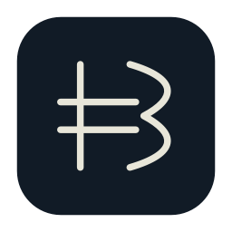
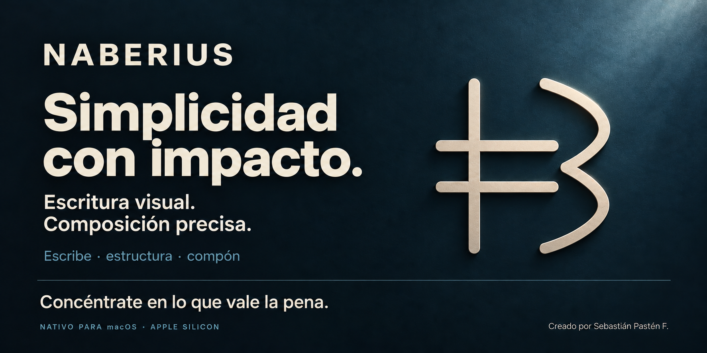
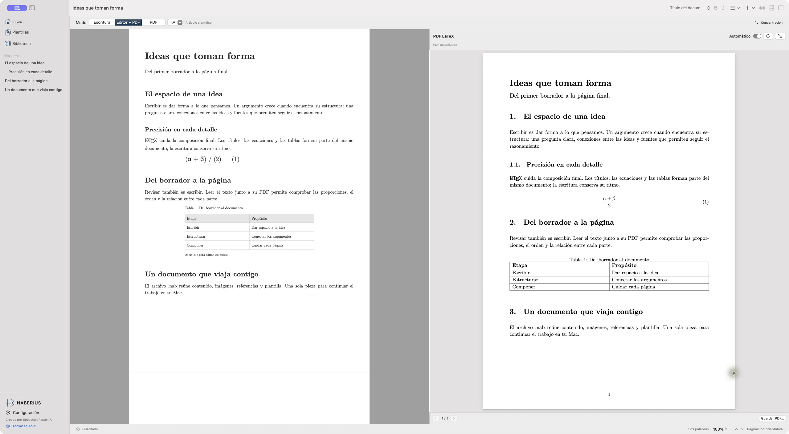
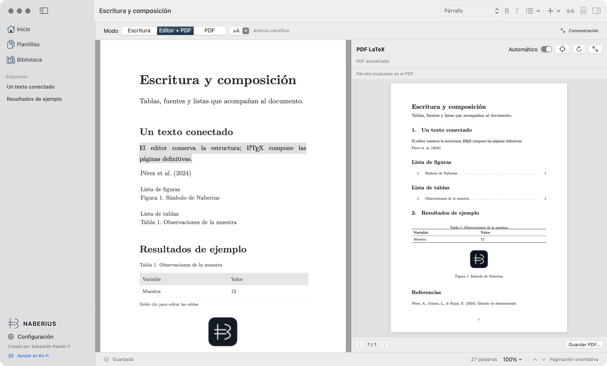
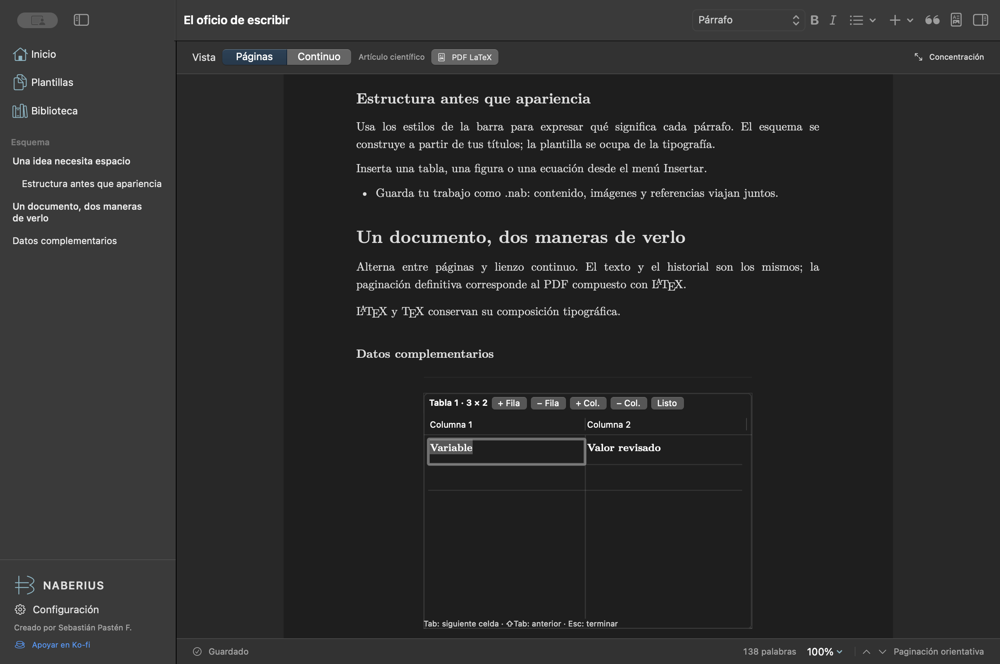
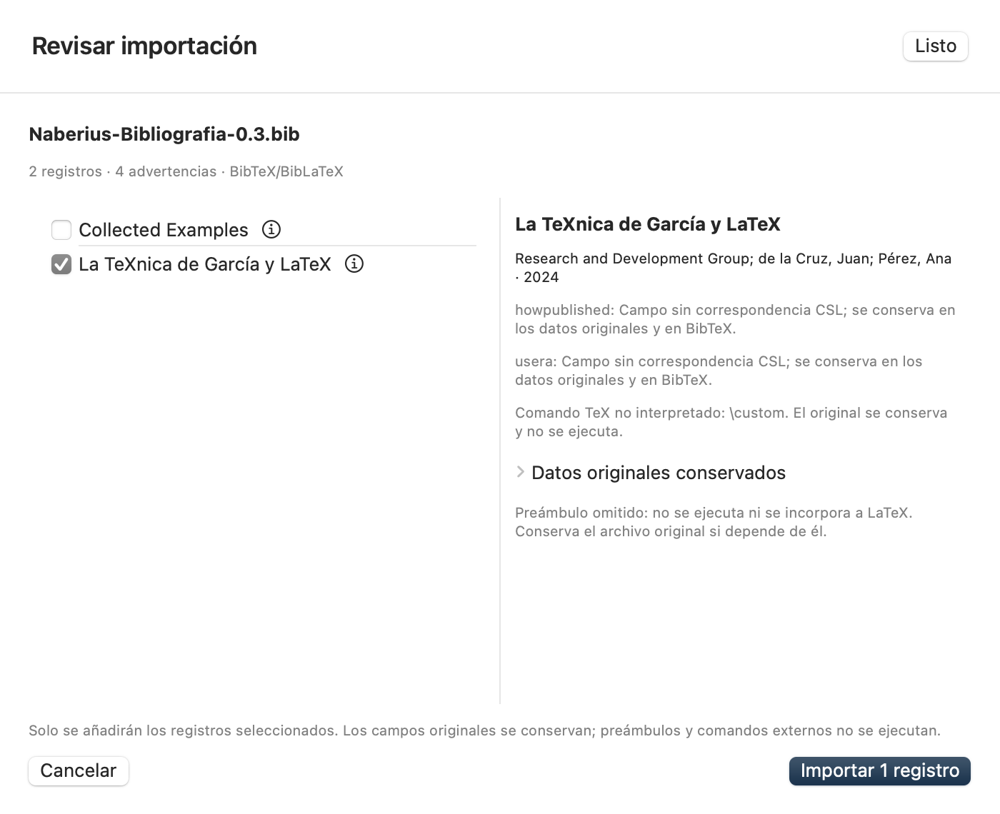

<div align="center">
  
  <h1>NABERIUS</h1>
  <p><strong>Escritura visual. Composición precisa.</strong></p>
  <p>Da forma a tus ideas y compón documentos con LaTeX en tu Mac.</p>
  <p>
    
    
    
  </p>
  <p><a href="https://github.com/AD0441/NABERIUS/releases/tag/v0.7.0">Descargar 0.7.0</a> · <a href="#qué-nos-diferencia">Ventajas</a> · <a href="#en-uso">En uso</a> · <a href="#empezar">Empezar</a> · <a href="docs/LIMITATIONS.md">Alcance</a> · <a href="https://ko-fi.com/C0C51WQ1T0">Apoyar</a></p>
</div>



**NABERIUS** reúne escritura estructurada, ecuaciones, tablas y bibliografía en un espacio de trabajo para artículos, tesis e informes. Escribe visualmente y revisa el PDF que compone **LaTeX mediante Tectonic**. Contenido, imágenes, plantilla y referencias viajan juntos en un archivo portable `.nab`.

**Creado por Sebastián Pastén F.** Pertenece a la familia de [METATRON](https://github.com/AD0441/METATRON), [RAZIEL](https://github.com/AD0441/RAZIEL) y [PAIMON](https://github.com/AD0441/PAIMON): herramientas nativas, procesamiento local y apoyo voluntario.

**Versión actual: [Naberius 0.7.0 — versión preliminar para Apple Silicon](https://github.com/AD0441/NABERIUS/releases/tag/v0.7.0).** Añade navegación SyncTeX entre escritura y PDF. Incluye citas narrativas CSL, pegado de rangos en tablas y listas automáticas de figuras y tablas, además de las tres vistas y plantillas editoriales en ZIP. [Descargar la app](https://github.com/AD0441/NABERIUS/releases/download/v0.7.0/Naberius.zip) · [Historial de cambios](CHANGELOG.md).

## Simplicidad con impacto

**Concéntrate en lo que vale la pena.** Creamos herramientas nativas para Mac que reúnen lo necesario en un flujo claro: menos pasos repetidos, decisiones visibles y control sobre tu trabajo. En NABERIUS, eso significa dedicar tu atención a las ideas, con escritura estructurada y el PDF real a la vista.

Compartimos una filosofía y una [identidad visual](docs/FAMILY.md); cada aplicación conserva su propósito, su sello y sus límites.

## Qué nos diferencia

| Lo que necesitas | Nuestra ventaja práctica | Alcance que debes conocer |
| --- | --- | --- |
| Escribir y componer sin separar el trabajo | Editor visual, tablas, ecuaciones y bibliografía junto al PDF compuesto por LaTeX. | La página editable es orientativa; el PDF determina la composición final. |
| Conservar el formato editorial y tus recursos | Plantillas ZIP y un archivo portable `.nab` con texto, imágenes y referencias; exportación del proyecto LaTeX. | Tectonic se instala por separado y la preparación inicial de paquetes puede requerir Internet. |
| Elegir un espacio propio para escribir | Aplicación nativa, documentos locales, sin cuenta ni telemetría. | La compatibilidad con macros y clases depende del paquete; revisa los avisos. |

Si valoras la colaboración simultánea desde el navegador, [Overleaf](https://www.overleaf.com/about/features-overview) está orientado a ese trabajo y también ofrece edición visual. NABERIUS se centra en la escritura individual nativa y el proyecto local portable; no incluye coedición en tiempo real. La edición visual y LaTeX no son funciones exclusivas: la ventaja está en cómo se reúnen aquí. [Alcance real](docs/STATUS.md) · [Privacidad](docs/PRIVACY.md).

## Qué hacemos y qué hacemos mejor

Naberius acompaña el recorrido del borrador al documento compuesto: escribir con estructura, reunir las fuentes y comprobar cómo quedará cada página.


*Imagen promocional generada con IA a partir de la aplicación real. Las capturas de «En uso» muestran la app instalada.*

- **Escribir con estructura:** títulos, esquema, énfasis, listas, enlaces, búsqueda y reemplazo. Fuentes Latin Modern incluidas y apariencia clara, oscura o del sistema.
- **Trabajar con objetos académicos:** tablas editables dentro del documento, figuras, ecuaciones, notas, índice y referencias cruzadas.
- **Revisar el PDF real:** composición LaTeX, navegación, zoom y guardado. Actualización manual o después de una pausa configurable.
- **Usar tu formato editorial:** importar un ZIP con su clase, macros y recursos; revisar los campos detectados y escribir en una plantilla de revista.
- **Configurar el diseño:** artículo, informe, tesis, libro o carta; una o dos columnas, separación, márgenes por lado, sangría, cabeceras y pies.
- **Organizar fuentes:** APA 7, IEEE, Vancouver y Chicago autor-fecha mediante citeproc-js local. Importar BibTeX/BibLaTeX, RIS o CSL-JSON con revisión previa.
- **Conservar el trabajo:** un archivo `.nab`, guardado atómico, detección de conflictos y recuperación local. Exportar el proyecto LaTeX con sus recursos.

La [matriz de requisitos](docs/STATUS.md) y los [límites conocidos](docs/LIMITATIONS.md) describen el alcance real de la versión.

### Qué mejoramos en tu flujo de trabajo

| Tarea | Cómo ayuda Naberius |
| --- | --- |
| **Escribir y revisar la composición** | Editor y PDF real en la misma ventana, con actualización tras una pausa configurable. |
| **Preparar el formato de una revista** | Importación de ZIP que conserva la clase y los recursos originales; revisión de los campos detectados y aviso si faltan archivos. |
| **Revisar referencias antes de incorporarlas** | Selección de registros, campos conservados y advertencias de importación en una misma revisión. |
| **Llevar el trabajo a otro Mac** | Un archivo `.nab` reúne texto, imágenes, bibliografía y plantilla. También puedes exportar el proyecto LaTeX. |

La escritura aproxima el formato; el PDF confirma las columnas, los saltos y la composición final.

## En uso

Vista **Editor + PDF** de Naberius 0.5.0 con el documento original de demostración [Ideas que toman forma](docs/examples/Ideas-que-toman-forma.nab). A la izquierda se escribe; a la derecha se comprueba la composición real de LaTeX.



En **0.7.0**, selecciona un párrafo y pulsa **⌥⌘J** para encontrarlo en el PDF real. Haz **⌘-clic** sobre texto del PDF para volver al editor. El mapa se renueva con cada composición y los saltos se bloquean mientras el PDF esté desactualizado. [Cómo usar SyncTeX](docs/SYNCTEX.md) · [Abrir este ejemplo](docs/examples/Escritura-y-composicion-0.6.nab).



Las capturas siguientes documentan la edición de tablas y la revisión bibliográfica introducidas en 0.3.0.

| Tablas dentro del documento | Revisión de la importación bibliográfica |
| --- | --- |
|  |  |

## Tres formas de trabajar

Elige la vista sobre el documento y configura la predeterminada en **Configuración → General → Escritura y PDF**.

| Vista | Para qué sirve |
| --- | --- |
| **Escritura** | Una página editable orientativa o un lienzo continuo para desarrollar el texto. Puedes ajustar el ancho de escritura. |
| **Editor + PDF** | Escribir y comprobar el PDF real al mismo tiempo. El divisor permite repartir el espacio entre ambas vistas. |
| **PDF** | Revisar la composición final a todo el ancho, navegar, ampliar y guardar el resultado. |

La página editable aproxima el formato; los saltos, las columnas y la paginación definitiva se comprueban en el PDF. Cambiar de vista conserva el contenido, la selección y el historial.

La actualización automática espera **2, 4 u 8 segundos** después de escribir y solo se programa en la vista dividida con la ventana activa. Puedes desactivar **Automático** y actualizar con **⇧⌘R**. El motor no se ejecuta por cada pulsación. [Guía de vistas y composición](docs/EDITOR_MODES.md).

## Del ZIP de una revista al documento

En **Configuración → Plantillas → Importar plantilla**, selecciona el ZIP editorial. Naberius detecta el documento principal, conserva la clase y los recursos originales, y ofrece los campos de metadata reconocidos. La composición usa ese paquete; no exige crear un adaptador específico para cada revista.

Si faltan clases o estilos, puedes **Completar recursos…**. **Crear diseño libre** permite partir del contenido con un diseño configurable. La compatibilidad depende de los archivos y macros del paquete; una variante libre no certifica el formato de una revista.

Se han probado paquetes IEEE, JIMIS y MECS. El ZIP CJS ensayado carecía de su clase requerida; la app informa el recurso ausente. Los paquetes aportados para pruebas no se redistribuyen en este repositorio. [Funcionamiento, formatos probados y límites](docs/TEMPLATE_PACKAGES.md).

## Bibliografía y tablas

En **Biblioteca → Importar**, revisa registros, campos y advertencias antes de añadir las fuentes. La importación reconoce abreviaturas `@string`, concatenación `#`, `crossref`, `xdata`, nombres institucionales, acentos y fechas. Los campos adicionales y los datos originales se conservan; las limitaciones se muestran durante la revisión. No se promete compatibilidad universal con todas las extensiones BibLaTeX. [Bibliografía](docs/BIBLIOGRAPHY.md).

Haz doble clic en una tabla para editar sus celdas dentro del documento. **Tab / ⇧Tab** cambian de celda, **Intro** avanza de fila y **Esc** termina la edición. Tab en la última celda añade una fila hasta el límite de 200. La vista puede abreviar tablas largas; el PDF conserva sus filas. [Tipografía y composición](docs/TYPESETTING.md).

## Empezar

[Descargar Naberius 0.7.0 para Apple Silicon](https://github.com/AD0441/NABERIUS/releases/tag/v0.7.0) · [Comprobar SHA-256](https://github.com/AD0441/NABERIUS/releases/download/v0.7.0/Naberius.zip.sha256)

Requiere **macOS 14 o posterior**. La app se ha verificado en un Apple M1 con 8 GB; Intel no está verificado. El ZIP tiene firma local ad hoc y no está notarizado.

1. Descomprime el ZIP y coloca **Naberius.app** en Aplicaciones.
2. Crea un documento en blanco, elige una plantilla o abre el ejemplo incluido en este repositorio.
3. Aplica estilos y añade tablas, figuras, ecuaciones o referencias desde los menús.
4. Guarda con **⌘S** y elige **Editor + PDF** para revisar la composición.

**Tectonic se instala por separado.** Puedes escribir y exportar el proyecto LaTeX sin el motor. Para producir el PDF, selecciona Tectonic en **Configuración → Composición** si no se detecta. La preparación inicial de paquetes puede requerir conexión y se inicia expresamente desde allí; después se utiliza la caché local.

Para compilar desde el código, usa Xcode con Swift 6.2 o posterior:

```sh
git clone https://github.com/AD0441/NABERIUS.git
cd NABERIUS
./script/build_and_run.sh
```

El script crea y verifica el bundle, produce `dist/Naberius.zip` e instala `~/Applications/Naberius.app`. `--build-only` solo genera el ZIP; `NABERIUS_APP_DIR` permite elegir el destino de instalación.

## Local por decisión

Naberius funciona sin cuenta y guarda los documentos en tu Mac. No incorpora telemetría ni exige una nube. La descarga de paquetes de composición y la apertura de enlaces, incluido Ko-fi, requieren una acción explícita. [Privacidad](docs/PRIVACY.md).

La interfaz usa SwiftUI, AppKit/TextKit y PDFKit. La composición y el trabajo de disco se realizan fuera de la escritura interactiva. La verificación en Apple Silicon no se presenta como garantía general de memoria, batería o latencia.

## Validación

La versión 0.7.0 pasó **108 pruebas** localmente, incluidas integraciones con Tectonic y SyncTeX reales, plantillas ZIP y pruebas AppKit. Se comprobaron en pantalla ambos sentidos de navegación, el bloqueo del PDF desactualizado y la renovación del mapa al recomponer. [CI](https://github.com/AD0441/NABERIUS/actions) · [Pruebas y evidencias](docs/TESTING.md).

```sh
python3 script/sync_localization.py --check
./script/test.sh
./script/build_and_run.sh --build-only
# Integraciones con Tectonic instalado y paquetes disponibles:
NABERIUS_COMPOSE=1 ./script/test.sh
```

Las pruebas ordinarias de CI omiten el motor externo. Esta versión mantiene requisitos pendientes; la auditoría integral de accesibilidad queda para una fase posterior.

## Contribuir

Los aportes son bienvenidos: [errores y propuestas](https://github.com/AD0441/NABERIUS/issues), pruebas con documentos anonimizados, compatibilidad editorial y traducciones. Consulta [CONTRIBUTING.md](CONTRIBUTING.md).

[Arquitectura](docs/ARCHITECTURE.md) · [Formato `.nab`](docs/DOCUMENT_FORMAT.md) · [Plantillas ZIP](docs/TEMPLATE_PACKAGES.md) · [Material para la web](docs/PRESENTATION.md)

## Apoyar el proyecto

Los aportes voluntarios ayudan a mantener el desarrollo y las pruebas de Naberius.

[](https://ko-fi.com/C0C51WQ1T0)

## Identidad y licencia

El sello simplificado de Naberius conserva el azul profundo y el marfil de la familia. Su geometría original combina un asta, dos barras y una curva abierta. Se incluyen SVG, PNG, ICNS y el [generador de iconos](script/make_brand.swift). La portada actual adopta la [identidad común de la familia](docs/FAMILY.md); la [base geométrica anterior](script/make_cover_reference.swift) y su [dirección artística](docs/assets/brand/cover-prompt.txt) se conservan como antecedentes. [Criterios de identidad](docs/BRAND.md) · [Procedencia de la portada](docs/PRESENTATION.md).

Código propio: **AGPL-3.0-or-later**, copyright 2026 Sebastián Pastén F. Los componentes de terceros conservan sus licencias: [avisos](THIRD_PARTY_NOTICES.md), [licencia](LICENSE) y [autoría](COPYRIGHT). citeproc-js se utiliza bajo su opción AGPL; las fuentes Latin Modern conservan GUST y los estilos/locales CSL, CC BY-SA.

<div align="center">
  <p><strong>Simplicidad con impacto.</strong><br>Concéntrate en lo que vale la pena.</p>
  <p><a href="https://github.com/AD0441/NABERIUS">NABERIUS</a> · <a href="https://github.com/AD0441/RAZIEL">RAZIEL</a> · <a href="https://github.com/AD0441/METATRON">METATRON</a> · <a href="https://github.com/AD0441/PAIMON">PAIMON</a> · <a href="https://github.com/AD0441/VAPULA">VAPULA</a></p>
  <p><strong>Creado por Sebastián Pastén F.</strong></p>
  <p><a href="https://www.sebastianpasten.com/desarrollos-aplicaciones-para-mac-software-sdr">Más aplicaciones para Mac</a> · <a href="https://ko-fi.com/C0C51WQ1T0">Apoyar en Ko-fi</a></p>
</div>
