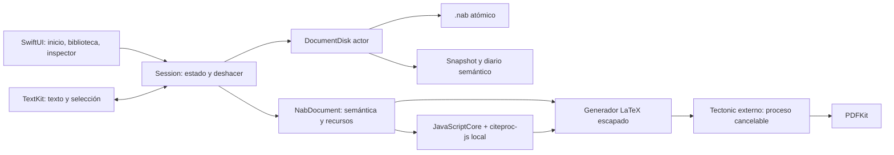

# Arquitectura

Naberius es una aplicación nativa para macOS 14+, construida con Swift 6, SwiftUI y AppKit. Se priorizan integridad, escritura responsiva y funcionamiento local. El editor usa TextKit mediante una única instancia de NSTextView: macOS aporta selección, foco, ortografía, menús contextuales y edición de texto. SwiftUI aporta navegación, controles, biblioteca y propiedades. No se incorpora un navegador ni Electron.

## Decisiones

- **Edición nativa frente a WebKit/ProseMirror:** evita un runtime web, comparte la ortografía y accesibilidad del sistema y reduce dependencias. Los objetos académicos se representan como adjuntos; tablas y matemáticas se editan en un inspector, no como una hoja de cálculo dentro del texto. Esta es una decisión de la versión inicial y limita la fluidez del ajuste de celdas en el propio documento.
- **Semántica por valor:** bloques, marcas y nodos con UUID. La representación visual no es el formato maestro. Las referencias cruzadas se resuelven según el orden real de los adjuntos.
- **DocumentDisk actor:** lectura, compresión, checksum, snapshots y diario fuera del actor principal. La UI captura transacciones de modelo. El diario guarda bloques cambiados y arrays solo cuando cambian; el snapshot se consolida tras unos 2 s.
- **Deshacer:** UndoManager compartido para texto, propiedades y objetos. Límite de 100 operaciones. La instancia de editor se mantiene al alternar vistas.
- **Composición:** una tarea por operación, cancelación y límite de ejecución. No se compila por pulsación. El contenido generado se escapa. Las plantillas semánticas usan clases integradas; los paquetes ZIP conservan y compilan sus clases TeX dentro del límite de procesos y archivos descrito en TEMPLATE_PACKAGES.md. El análisis no ejecuta código de los paquetes.
- **Citas:** citeproc-js en JavaScriptCore, sin WebView ni red, con estilos y locales incluidos. Se crea un contexto por operación para aislar estado entre documentos.
- **Sin servidor:** no hay cuenta, autenticación, backend, telemetría ni sincronización de documentos.

## Recursos y presupuestos

Objetivos de desarrollo, no garantías: inicio <2 s en caliente, memoria inactiva <250 MB, trabajo sostenido de CPU cercano a cero al dejar de editar. Las mediciones se registran en TESTING.md. La serialización de documentos extensos está cubierta; el benchmark de almacenamiento no demuestra latencia de tecleo ni de composición.

## Evolución

Conservar el formato semántico al mejorar tablas en línea, matemáticas anidadas, paginación y navegación. P1 incorpora DOCX/Markdown, proyectos, estilos CSL propios y más interoperabilidad. El detalle contractual completo y el estado de cada requisito permanecen en REQUIREMENTS.md y STATUS.md.

## Revisión 0.2.0: composición visible

DocumentTypography expone las fuentes originales incluidas. CoreText las registra para TextKit y fontspec carga sus mismos archivos en el proyecto exportado. La apariencia del documento ya no depende de títulos de sistema. El logotipo usa un delegado de generación de glifos y marcas derivadas que no alteran los caracteres de TextRun.

TypesetProofView muestra el PDF del proceso real en el espacio de trabajo; el editor permanece montado al cambiar de vista. Session conserva la versión de edición de la composición y advierte si el PDF está desactualizado. Compilation registra motor, duración y fecha; CompositionFailure separa explicación de registro técnico. EquationTypesetter recorta una salida PDF matemática real y mantiene una caché transitoria acotada.

DocumentFragment copia dependencias y remapea identidades al pegar. Los cambios de recursos y texto comparten un grupo de UndoManager. Las tablas siguen siendo objetos editados por campos de inspector; los tres estilos ya se exportan de forma distinta con tabularx/booktabs.

## Vistas y composición 0.5.0

EditorMode separa Escritura, Editor + PDF y PDF. ComparisonWorkspace usa NSSplitView y dos NSHostingView constantes: AppKit controla los anchos y conserva la proporción elegida; SwiftUI mantiene el contenido y el NSTextView montado. Session programa una única espera cancelable después de una edición en modo combinado activo, y solo permite caché local para actualización automática. Un token de operación y la identidad del documento rechazan resultados cancelados u obsoletos. DocumentCompiling permite verificar esta coordinación sin lanzar procesos en tests unitarios. Los errores automáticos permanecen en la vista y no abren alertas. Se retienen como máximo las dos composiciones más recientes; Composer elimina solo sus directorios temporales propios.
