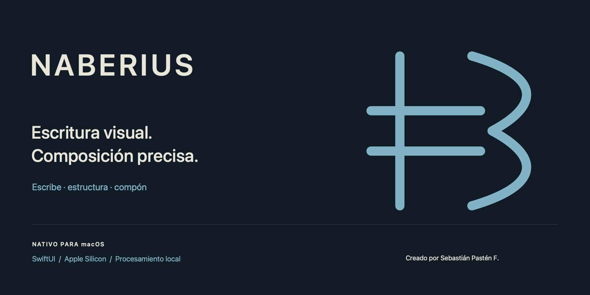
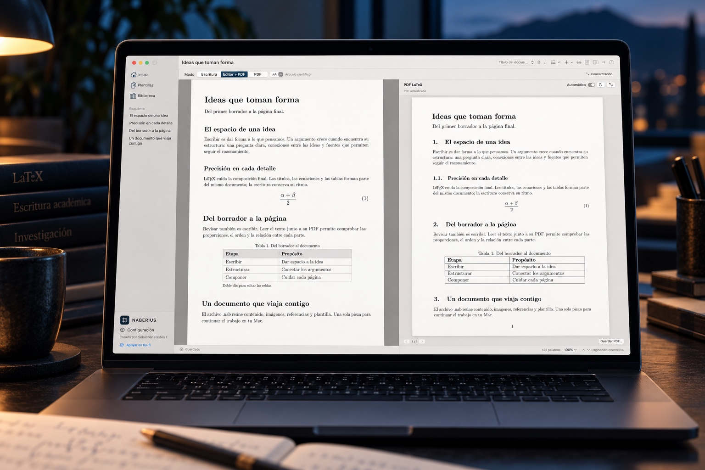

# Material para la web

Preparado el 1 de noviembre de 2026 para la colección de [desarrollos de Sebastián Pastén](https://www.sebastianpasten.com/desarrollos-aplicaciones-para-mac-software-sdr). Mantiene el formato de sus fichas: nombre, frase breve, descripción, compatibilidad y enlace.

## Texto de la ficha

**NABERIUS**

**Escritura visual. Composición precisa.**

Redacta artículos, tesis e informes sin escribir código LaTeX. Organiza citas, ecuaciones y tablas, importa plantillas de revistas en ZIP y revisa el PDF mientras escribes, con tus documentos guardados en tu Mac.

**Apple Silicon · macOS 14 o posterior**

[Conocer y descargar](https://github.com/AD0441/NABERIUS/releases/tag/v0.5.0)

La composición del PDF requiere Tectonic instalado por separado. La versión enlazada es preliminar; su alcance se describe en el README y los límites conocidos.

## Portada gráfica del repositorio

La portada principal del README sigue la referencia de METATRON aportada por el autor: formato 2:1, fondo navy, nombre y lema a la izquierda, sello original de Naberius a la derecha, divisor y pie con plataforma y autoría. Usa las tintas de la familia y conserva la geometría simplificada del sello.

- [PNG de portada](assets/brand/cover.png): 1600 × 800.
- [Generador nativo reproducible](../script/make_cover.swift): ejecutar `xcrun swift script/make_cover.swift` desde la raíz del repositorio.
- Renderizado con AppKit, tipografía del sistema y geometría original. La referencia de METATRON se consulta sin copiar su símbolo ni modificar su proyecto.

## Fotografía para la web y la sección de capacidades

- [JPEG para la web](assets/marketing/naberius-cover.jpg): 1536 × 1024, proporción 3:2, versión ligera.
- [PNG original](assets/marketing/naberius-cover.png): 1536 × 1024.
- Texto alternativo: «Un Mac muestra Naberius con un documento académico editable y su PDF compuesto con LaTeX, en un escritorio de tonos azul petróleo».
- Conservar la imagen completa cuando se use como fotografía de presentación. Para una tarjeta cuadrada, centrar el recorte sobre la pantalla; las dos páginas son el motivo principal.
- Evitar texto superpuesto: el nombre, la frase y la descripción pertenecen a los campos de la ficha.

## Procedencia

La fotografía es una recreación generada con IA mediante image_gen. Usa como referencias una captura real de Naberius 0.5.0, su icono existente y la fotografía promocional de METATRON para conservar la estética de la familia. No es una captura de pantalla ni evidencia de exactitud tipográfica. El [prompt completo](assets/marketing/naberius-cover-prompt.txt) conserva las instrucciones de generación. La conversión a JPEG conserva composición y dimensiones. En el README se mantiene más abajo, dentro de «Qué hacemos y qué hacemos mejor»; la portada principal es el recurso geométrico.

La [captura real de Editor + PDF](screenshots/editor-pdf-0.5.jpg) procede del control nativo de la app instalada el 1 de noviembre de 2026. Muestra el documento propio [Ideas que toman forma](examples/Ideas-que-toman-forma.nab), creado para esta presentación a partir de los modelos integrados, y un PDF producido realmente por Tectonic. El archivo usa Latin Modern, una ecuación y una tabla con contenido sintético. No contiene clases, recursos ni documentos de las revistas aportadas para pruebas.

Las capturas históricas de tablas y bibliografía del README corresponden a 0.3.0 y conservan esa identificación. Los recursos de METATRON se consultaron como referencia sin modificarlos ni redistribuirlos.

## Autoría y apoyo

**Creado por Sebastián Pastén F.**

[Apoyar en Ko-fi](https://ko-fi.com/C0C51WQ1T0) · [Repositorio](https://github.com/AD0441/NABERIUS)
